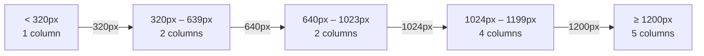

# Implementation Plan 2: Mobile Filter Layout

**Project:** Opportunities Portal — بوابة الفرص  
**Scope:** CSS layout refactoring for mobile filter controls  
**Date:** 20 October 2026  
**Status:** ✅ Approved — finalized as documentation

---

## Goal Description

Refactor the search-and-filter section (`search-filters-section`) for optimal mobile usability at the **360px minimum viewport width**. The current filters grid already uses `grid-template-columns: repeat(2, minmax(0, 1fr))` at mobile widths, but this plan documents all layout requirements, edge cases, and verification criteria to ensure a complete, polished result.

**Objectives:**
1. **Two-column filter grid** — Display filter dropdowns (نوع الفرصة, المجال والتخصص, المستوى الدراسي, الدولة/الوجهة, حالة التقديم) in a two-column grid at 360px.
2. **Full-width search field** — The keyword search input must remain 100% width above the filter grid on all breakpoints.
3. **Preserve RTL/LTR** — Layout must render correctly in both `dir="rtl"` (Arabic default) and `dir="ltr"` (English toggle) without any text truncation or overflow.
4. **Preserve dark mode** — All filter controls must honor the `html[data-theme="dark"]` CSS variable overrides.
5. **Preserve desktop layout** — The existing 4-column (≥1024px) and 5-column (≥1200px) filter grids must remain unaffected.

---

## User Review Required

> [!IMPORTANT]
> **No functionality changes** — This plan modifies only CSS layout rules and related HTML structure constraints. No JavaScript logic, data files, or opportunity records are altered.

> [!WARNING]
> **Sub-320px fallback** — The current CSS includes a `@media (max-width: 319px)` rule that collapses filters to a single column for extremely narrow viewports. This plan preserves that behavior. Please confirm this is acceptable or specify an alternative.

**Design decisions requiring your input:**

| Decision | Current behavior | Proposed |
|---|---|---|
| Filter grid columns at 360px | 2 columns (`repeat(2, minmax(0, 1fr))`) | Keep 2 columns — no change |
| 5th filter (حالة التقديم) placement | Spans naturally into a new row in the 2-col grid (row 3, col 1) | Keep as-is: 5th filter sits alone in row 3 |
| Sub-320px single-column fallback | Active via `@media (max-width: 319px)` | Preserve |
| Gap between filter groups | `12px` | Keep `12px` |

---

## User Decision

> [!IMPORTANT]
> **Keep existing layout unchanged.** The user reviewed the current responsive CSS and confirmed that no layout modifications are needed. This plan documents the existing implementation as-is and defines the verification criteria.

---

## Proposed Changes

> **No CSS or HTML changes are proposed.** The sections below document the existing implementation for reference and verification purposes.

### Component 1: Search Box (full-width)

#### [MODIFY] style.css — `.search-box-wrapper` (lines 160–163)

The search field is already full-width. Verify and enforce:

```css
/* Current — no change needed */
.search-box-wrapper {
  position: relative;
  margin-block-end: 16px;   /* separates search from filter grid */
}

.search-input {
  width: 100%;              /* ✅ already full-width */
  height: 48px;
  /* ... padding, border, etc. unchanged */
}
```

> [!NOTE]
> The search input's `width: 100%` and the wrapper's block layout already guarantee full-width rendering at every breakpoint. **No CSS change needed here.**

---

### Component 2: Filters Grid (two-column mobile layout)

#### [MODIFY] style.css — `.filters-grid` responsive rules (lines 219–251)

Current responsive cascade (already in place):

```css
/* Mobile default (320px–639px): two columns */
.filters-grid {
  display: grid;
  grid-template-columns: repeat(2, minmax(0, 1fr));
  gap: 12px;
}

/* Prevent overflow on each cell */
.filters-grid > .filter-group {
  min-width: 0;
}
.filters-grid .filter-select {
  width: 100%;
  min-width: 0;
}

/* Sub-320px: single column fallback */
@media (max-width: 319px) {
  .filters-grid {
    grid-template-columns: minmax(0, 1fr);
  }
}

/* Tablet (≥640px): two columns */
@media (min-width: 640px) {
  .filters-grid {
    grid-template-columns: repeat(2, 1fr);
  }
}

/* Desktop (≥1024px): four columns */
@media (min-width: 1024px) {
  .filters-grid {
    grid-template-columns: repeat(4, 1fr);
  }
}

/* Wide desktop (≥1200px): five columns — one per filter */
@media (min-width: 1200px) {
  .filters-grid {
    grid-template-columns: repeat(5, minmax(0, 1fr));
  }
}
```

**Assessment:** The two-column mobile grid is already correctly implemented. The key `minmax(0, 1fr)` pattern prevents long Arabic label overflow by allowing columns to shrink below their content width.

---

### Component 3: Filter Controls — RTL/LTR Compatibility

#### [MODIFY] style.css — Logical properties audit

All filter-related CSS already uses **CSS Logical Properties**:

| Property | Value | RTL safe? |
|---|---|---|
| `.filter-select` → `padding-inline` | `12px` | ✅ |
| `.search-input` → `padding-inline-start` | `44px` | ✅ |
| `.search-input` → `padding-inline-end` | `44px` | ✅ |
| `.search-icon` → `inset-inline-start` | `14px` | ✅ |
| `.search-clear-btn` → `inset-inline-end` | `12px` | ✅ |
| `.search-filters-section` → `margin-block-end` | `24px` | ✅ |
| `.container` → `padding-inline` | `16px` | ✅ |

> [!TIP]
> The `[dir="ltr"]` selector rules at line 1002–1004 of `style.css` handle LTR overrides for card metadata and modal rows. No additional LTR rules are needed for the filter grid since `grid` layout is direction-agnostic.

---

### Component 4: Dark Mode Compatibility

#### [MODIFY] style.css — Dark theme filter overrides (lines 1031–1034)

Already covered:

```css
html[data-theme="dark"] .search-input,
html[data-theme="dark"] .filter-select,
html[data-theme="dark"] .reset-filters-btn {
  background: var(--color-surface-alt);
  color: var(--color-text);
  border-color: var(--color-border);
}

html[data-theme="dark"] .search-filters-section {
  background: var(--color-surface);
  color: var(--color-text);
  border-color: var(--color-border);
}
```

> [!NOTE]
> Dark mode variables cascade through the existing `:root` / `html[data-theme="dark"]` system. All filter controls inherit correctly. **No additional dark-mode CSS needed.**

---

### Component 5: HTML Structure (index.html)

#### [MODIFY] index.html — Filter section (lines 66–141)

The HTML structure supports the CSS grid layout:

```
search-filters-section
└── container
    ├── search-box-wrapper          ← full-width (block)
    │   ├── search-icon (SVG)
    │   ├── input#search-input
    │   └── button#search-clear-btn
    └── filters-grid                ← CSS Grid container
        ├── .filter-group (نوع الفرصة)
        ├── .filter-group (المجال والتخصص)
        ├── .filter-group (المستوى الدراسي)
        ├── .filter-group (الدولة / الوجهة)
        └── .filter-group (حالة التقديم)
```

**5 filter groups in a 2-column grid produce:**
- Row 1: filter 1 | filter 2
- Row 2: filter 3 | filter 4
- Row 3: filter 5 | *(empty cell)*

> [!NOTE]
> **No HTML changes needed.** The existing structure is already correct for the two-column mobile layout.

---

### Responsive Breakpoint Summary



---

## Verification Plan

### Automated Tests

```bash
# 1. Python overflow detection script (checks for horizontal scroll at 360px)
python scripts/check_overflow.py

# 2. Browser-based milestone verification
python scripts/test_milestone2_browser.py

# 3. UI logic unit tests
python scripts/test_ui_logic.py
```

### Manual Verification

> [!IMPORTANT]
> **Actual viewport width required** — All 360px checks must use the browser's real measured viewport width (e.g. Chrome DevTools device toolbar set to exactly 360px, or `window.innerWidth === 360` confirmed in the console), not an assumed or approximate value.

| Check | Viewport | Theme | Direction | Expected Result |
|---|---|---|---|---|
| Search field spans full width | 360px (measured) | Light | RTL | ✅ No side gaps, no overflow |
| Filters show 2 per row | 360px (measured) | Light | RTL | ✅ Two equal-width dropdowns per row |
| 5th filter on its own row | 360px (measured) | Light | RTL | ✅ حالة التقديم alone in row 3 |
| No horizontal scroll | 360px (measured) | Light | RTL | ✅ No scrollbar, no clipping |
| Dark mode colors | 360px (measured) | Dark | RTL | ✅ All controls use dark surface/border vars |
| LTR layout mirrors correctly | 360px (measured) | Light | LTR | ✅ Grid flips, labels align left |
| Desktop 5-column grid | 1280px | Light | RTL | ✅ All 5 filters in one row |
| Sub-320px single column | 280px | Light | RTL | ✅ Filters stack vertically |
| Long Arabic option text | 360px (measured) | Light | RTL | ✅ Text truncates or wraps, no overflow |

### Visual Regression Checklist

- [ ] Open `index.html` at exactly 360px width in Chrome DevTools (confirm `window.innerWidth === 360` in console) → verify 2-column filter grid
- [ ] Toggle to English → verify grid flips to LTR without layout shift
- [ ] Toggle dark mode → verify filter controls respect dark theme
- [ ] Resize to 1280px → verify 5-column desktop layout intact
- [ ] Resize to 280px → verify graceful single-column fallback
- [ ] Select every filter dropdown at 360px (measured) → verify no text clipping
