# Implementation Plan 3: Security Review & Remediation

**Project:** Opportunities Portal — بوابة الفرص  
**Scope:** Client-side security audit, targeted fixes, and regression testing  
**Date:** 20 October 2026  
**Status:** ✅ Approved — finalized as documentation

---

## Goal Description

Perform a focused security review of the static Opportunities Portal to identify and remediate avoidable client-side vulnerabilities. The portal is a **zero-dependency, static HTML/CSS/JS application** deployed on GitHub Pages — there is no backend server, database, or API. The review scope is:

| Area | What to check |
|---|---|
| **XSS (Cross-Site Scripting)** | All dynamic HTML rendering paths in `app.js` and `ui-preferences.js` |
| **HTTPS Link Safety** | All outgoing `official_url` links and `target="_blank"` usage |
| **Exposed Secrets** | Scan all source files for API keys, credentials, tokens |
| **localStorage Security** | Favorites (`FAVORITES_KEY`) and preferences (`LANG_KEY`, `THEME_KEY`) |
| **Service Worker Security** | Fetch interception scope, cache poisoning vectors, origin checks |

---

## User Review Required

> [!IMPORTANT]
> **No architectural changes** — This plan proposes targeted, surgical fixes to existing code. No new files, dependencies, or build steps are introduced.

> [!CAUTION]
> **`innerHTML` usage** — The codebase uses `innerHTML` in `createCardElement()`, `buildModalHTML()`, `renderEmptyState()`, and `loadOpportunities()`. All dynamic values pass through `escapeHtml()`, which is the primary XSS defense. The review will verify completeness of this defense. A future improvement could adopt DOM-based construction (`createElement`), but that is a refactoring scope outside this plan.

> [!WARNING]
> **URL validation hardening** — The current `safeOfficialUrl()` function already rejects non-HTTPS, credential-embedded, and malformed URLs. This plan audits its coverage and proposes any necessary tightening.

---

## User Decision

> [!IMPORTANT]
> **Preserve all current security protections.** The user reviewed the audit findings and confirmed that the existing `escapeHtml()`, `safeOfficialUrl()`, same-origin Service Worker restriction, and localStorage error handling are adequate and must not be altered.

> [!NOTE]
> **Optional improvements only** — `safeCssClass()` and the CSP meta tag are classified as **optional future enhancements**, not required fixes. They are documented below for reference but are explicitly excluded from this plan's scope.

---

## Proposed Changes

> **No application file changes are proposed.** The sections below document the existing security posture for audit purposes. All current protections are retained as-is.

### Area 1: XSS — Dynamic HTML Rendering

#### Audit: [app.js](file:///c:/Users/DELL/Documents/opportunities-portal/js/app.js) — `escapeHtml()` (line 388)

**Current implementation:**

```javascript
function escapeHtml(str) {
  if (!str) return '';
  return str
    .toString()
    .replace(/&/g, '&amp;')
    .replace(/</g, '&lt;')
    .replace(/>/g, '&gt;')
    .replace(/"/g, '&quot;')
    .replace(/'/g, '&#039;');
}
```

**Finding:** ✅ Covers all five critical HTML entity substitutions. This is the standard OWASP-recommended HTML encoding set.

#### Audit: [app.js](file:///c:/Users/DELL/Documents/opportunities-portal/js/app.js) — `createCardElement()` (line 539)

**Template injection points checked:**

| Template variable | Escaped? | Line |
|---|---|---|
| `categoryInfo.label` | ✅ `escapeHtml()` | 565 |
| `deadlineInfo.label` | ✅ `escapeHtml()` | 568 |
| `item.title_ar` | ✅ `escapeHtml()` | 573 |
| `item.organization` | ✅ `escapeHtml()` | 585 |
| `item.field` | ✅ `escapeHtml()` | 591 |
| `item.country` | ✅ `escapeHtml()` via `countryLabel()` | 595 |
| `item.coverage` | ✅ `escapeHtml()` | 599 |
| `item.deadline` | ✅ `escapeHtml()` | 559, 603 |
| `item.id` | ✅ `escapeHtml(String())` | 612, 620 |
| `categoryInfo.className` | ⚠️ Not escaped — derived from `CATEGORY_MAP` constant | 564 |

#### Audit: [app.js](file:///c:/Users/DELL/Documents/opportunities-portal/js/app.js) — `buildModalHTML()` (line 112)

| Template variable | Escaped? | Line |
|---|---|---|
| `categoryInfo.label` | ✅ `escapeHtml()` | 133 |
| `deadlineInfo.label` | ✅ `escapeHtml()` | 134 |
| `item.title_ar` | ✅ `escapeHtml()` | 138 |
| `item.title_en` | ✅ `escapeHtml()` | 141 |
| `item.organization` | ✅ `escapeHtml()` | 153 |
| `item.field` | ✅ `escapeHtml()` | 160 |
| `item.country` | ✅ `escapeHtml()` via `countryLabel()` | 164 |
| `item.coverage` | ✅ `escapeHtml()` | 168 |
| `item.deadline` | ✅ `escapeHtml()` | 126, 172 |
| `item.official_url` | ✅ `escapeHtml(safeOfficialUrl())` | 199 |
| `item.verification_date` | ✅ `escapeHtml()` | 191–192 |
| `item.eligibility_ar` | ✅ `escapeHtml()` | 180 |
| `item.review_note_ar` | ✅ `escapeHtml()` | 183 |
| `item.id` | ✅ `escapeHtml(String())` | 214 |
| `categoryInfo.className` | ⚠️ Constant-derived | 133 |
| `deadlineInfo.badgeClass` | ⚠️ Constant-derived | 134 |

> [!NOTE]
> **`categoryInfo.className` and `deadlineInfo.badgeClass`** are derived from hardcoded constants (`CATEGORY_MAP` and `calculateDeadlineStatus`), not from user/data input. These are **safe by construction** — no attacker-controlled data flows into CSS class names. No fix required but documented for completeness.

#### Proposed Fix: Defensive class-name sanitization (optional — not required)

```javascript
// Optional defense-in-depth utility (NOT a required fix):
function safeCssClass(str) {
  if (!str) return '';
  return str.replace(/[^a-zA-Z0-9_-]/g, '');
}
```

> [!NOTE]
> This is a **future optional improvement** only. Class values come from hardcoded constants and are safe by construction. The user has explicitly confirmed this is not a required fix and should not be implemented as part of this plan.

---

### Area 2: HTTPS Link Validation

#### Audit: [app.js](file:///c:/Users/DELL/Documents/opportunities-portal/js/app.js) — `safeOfficialUrl()` (line 400)

**Current implementation:**

```javascript
function safeOfficialUrl(value) {
  if (typeof value !== 'string' || /[\x00-\x1f\x7f]/.test(value)) return '#';
  try {
    const url = new URL(value);
    if (url.protocol !== 'https:' || !url.hostname ||
        url.username || url.password) return '#';
    return url.href;
  } catch (_) { return '#'; }
}
```

**Security checks performed:**

| Check | Covered? |
|---|---|
| Rejects non-string input | ✅ |
| Rejects control characters | ✅ `[\x00-\x1f\x7f]` |
| Requires `https:` protocol | ✅ |
| Requires valid hostname | ✅ |
| Rejects embedded credentials (`user:pass@host`) | ✅ |
| Returns parsed `url.href` (normalized) | ✅ |
| Fallback to `#` on any failure | ✅ |
| Rejects `javascript:` protocol | ✅ (covered by `https:` check) |
| Rejects `data:` protocol | ✅ (covered by `https:` check) |

**Finding:** ✅ `safeOfficialUrl()` is robust. No changes needed.

#### Audit: `target="_blank"` usage

| File | Location | Has `rel="noopener noreferrer"`? |
|---|---|---|
| `app.js` — modal apply link | line 200–210 | ✅ |
| `index.html` | No external links in static HTML | N/A |

**Finding:** ✅ All dynamically created `target="_blank"` links include `rel="noopener noreferrer"`.

---

### Area 3: Exposed Secrets & Credentials

#### Audit Scope

| File | Size | Contains secrets? |
|---|---|---|
| [index.html](file:///c:/Users/DELL/Documents/opportunities-portal/index.html) | 9.9 KB | ❌ No |
| [app.js](file:///c:/Users/DELL/Documents/opportunities-portal/js/app.js) | 40.6 KB | ❌ No |
| [ui-preferences.js](file:///c:/Users/DELL/Documents/opportunities-portal/js/ui-preferences.js) | 20.5 KB | ❌ No |
| [sw.js](file:///c:/Users/DELL/Documents/opportunities-portal/sw.js) | 5.1 KB | ❌ No |
| [opportunities.json](file:///c:/Users/DELL/Documents/opportunities-portal/data/opportunities.json) | 20.6 KB | ❌ No |
| [.gitignore](file:///c:/Users/DELL/Documents/opportunities-portal/.gitignore) | 380 B | N/A — properly excludes `.env`, `*.key`, `*.pem`, `credentials.json`, `secrets/` |

**Patterns scanned for:**
- `API_KEY`, `api_key`, `apiKey`, `secret`, `token`, `password`, `passwd`
- `PRIVATE_KEY`, `private_key`, `AWS_`, `GOOGLE_`, `FIREBASE_`
- Inline Base64 blobs that could be encoded credentials
- Hardcoded bearer tokens or authorization headers

**Finding:** ✅ **No secrets found.** The application is a pure static site with no API calls requiring authentication. The `.gitignore` correctly excludes common secret file patterns.

---

### Area 4: localStorage Security

#### Audit: Storage keys used

| Key | File | Purpose | Data stored |
|---|---|---|---|
| `opportunities_portal_favorites` | [app.js](file:///c:/Users/DELL/Documents/opportunities-portal/js/app.js#L12) | Bookmark IDs | `JSON.stringify(Array.from(Set))` — array of string IDs |
| `opportunities_portal_language` | [ui-preferences.js](file:///c:/Users/DELL/Documents/opportunities-portal/js/ui-preferences.js#L4) | Language pref | `'en'` or `'ar'` |
| `opportunities_portal_theme` | [ui-preferences.js](file:///c:/Users/DELL/Documents/opportunities-portal/js/ui-preferences.js#L5) | Theme pref | `'dark'` or `'light'` |

**Security analysis:**

| Concern | Assessment |
|---|---|
| **Sensitive data exposure** | ✅ Safe — only UI preferences and opportunity IDs. No PII, credentials, or session tokens. |
| **localStorage tampering** | ✅ Handled — `loadFavorites()` wraps `JSON.parse()` in try/catch (line 46–58). Malformed data is gracefully ignored. |
| **Quota exceeded** | ✅ Handled — `saveFavorites()` wraps `setItem` in try/catch (line 61–67). |
| **Private browsing mode** | ✅ Handled — both read/write operations fail gracefully with empty defaults. |
| **XSS via stored values** | ✅ Safe — stored IDs are compared via `Set.has()`, never injected raw into HTML. All rendering passes through `escapeHtml()`. |
| **Cross-origin access** | ✅ Safe — localStorage is same-origin by design. |

**Proposed Fix:** None needed. The current implementation follows best practices for client-side preference storage.

---

### Area 5: Service Worker Security

#### Audit: [sw.js](file:///c:/Users/DELL/Documents/opportunities-portal/sw.js)

**Registration guard ([app.js](file:///c:/Users/DELL/Documents/opportunities-portal/js/app.js#L968-L975)):**

```javascript
if ('serviceWorker' in navigator &&
    (window.location.protocol === 'https:' ||
     ['localhost', '127.0.0.1'].includes(window.location.hostname))) {
  window.addEventListener('load', () => {
    navigator.serviceWorker.register('./sw.js', { scope: './' })
      .catch((error) => console.warn('Offline support is unavailable:', error));
  });
}
```

**Finding:** ✅ Registration is restricted to HTTPS and localhost.

#### Fetch handler security checks

| Check | Implementation | Line |
|---|---|---|
| Only intercept GET requests | ✅ `request.method !== 'GET'` → return | 74 |
| Only intercept HTTP(S) | ✅ `!request.url.startsWith('http')` → return | 74 |
| **Same-origin only** | ✅ `url.origin !== self.location.origin` → return | 81 |
| No third-party caching | ✅ Cross-origin requests are passed through | 81 |

**Cache management:**

| Concern | Assessment |
|---|---|
| **Cache poisoning** | ✅ Only caches responses with `status === 200` (navigation) or `response.ok` (assets) |
| **Stale cache cleanup** | ✅ Activate event deletes old `opportunities-portal-*` caches (line 44–62) |
| **Cache scope** | ✅ `CACHE_NAME = 'opportunities-portal-v11'` — version-stamped |
| **`skipWaiting()`** | ✅ Forces immediate activation — new SW version takes control on next navigation |
| **`clients.claim()`** | ✅ Immediate takeover of uncontrolled clients |

**Proposed Fix:** The same-origin restriction (line 81) was already added in a prior security remediation. No additional changes needed.

#### Proposed Hardening (optional — not required)

Add a `Content-Security-Policy` meta tag to `index.html` for defense-in-depth:

```html
<!-- Optional CSP hardening for GitHub Pages (no inline scripts used) -->
<meta http-equiv="Content-Security-Policy"
      content="default-src 'self'; script-src 'self'; style-src 'self' 'unsafe-inline'; img-src 'self' data:; connect-src 'self';">
```

> [!NOTE]
> **Future optional improvement only.** `'unsafe-inline'` for styles is needed because inline SVG `fill` attributes and `style=""` attributes are used in the HTML. The user has explicitly confirmed this is not a required fix and should not be implemented as part of this plan.

---

## Summary of Findings

```mermaid
flowchart TD
    A["Security Audit Areas"] --> B["XSS Prevention"]
    A --> C["HTTPS Links"]
    A --> D["Exposed Secrets"]
    A --> E["localStorage"]
    A --> F["Service Worker"]

    B --> B1["✅ escapeHtml covers all 5 entities"]
    B --> B2["✅ All template vars escaped"]
    B --> B3["⚡ Optional: safeCssClass utility"]

    C --> C1["✅ safeOfficialUrl rejects non-HTTPS"]
    C --> C2["✅ Rejects embedded credentials"]
    C --> C3["✅ noopener noreferrer on all _blank"]

    D --> D1["✅ No API keys or tokens found"]
    D --> D2["✅ .gitignore covers secret patterns"]

    E --> E1["✅ Only UI prefs stored"]
    E --> E2["✅ try/catch on all operations"]
    E --> E3["✅ No PII or credentials"]

    F --> F1["✅ Same-origin fetch restriction"]
    F --> F2["✅ HTTPS/localhost registration"]
    F --> F3["✅ Version-stamped cache cleanup"]
    F --> F4["⚡ Optional: CSP meta tag"]
```



| Area | Status | Required fixes | Optional future improvement |
|---|---|---|---|
| XSS | ✅ Pass | None | `safeCssClass()` (not required) |
| HTTPS links | ✅ Pass | None | — |
| Exposed secrets | ✅ Pass | None | — |
| localStorage | ✅ Pass | None | — |
| Service Worker | ✅ Pass | None | CSP meta tag (not required) |

---

## Verification Plan

### Automated Tests

```bash
# 1. JavaScript syntax validation
python -c "import subprocess; subprocess.run(['node', '--check', 'js/app.js'], check=True); subprocess.run(['node', '--check', 'js/ui-preferences.js'], check=True); subprocess.run(['node', '--check', 'sw.js'], check=True)"

# 2. Security regression tests (existing suite)
python scripts/test_security_regression.py

# 3. Release smoke tests
python scripts/test_release_smoke.py

# 4. Data validation
python scripts/validate_data.py
```

### Security Regression Test Coverage

The existing [`test_security_regression.py`](file:///c:/Users/DELL/Documents/opportunities-portal/scripts/test_security_regression.py) should verify:

| Test | What it checks |
|---|---|
| `escapeHtml` completeness | All 5 HTML entities encoded |
| `safeOfficialUrl` rejects `http://` | Protocol enforcement |
| `safeOfficialUrl` rejects `javascript:` | XSS vector blocking |
| `safeOfficialUrl` rejects credentials | `user:pass@host` rejection |
| `safeOfficialUrl` accepts valid HTTPS | Positive case |
| `rel="noopener noreferrer"` present | Link isolation |
| Same-origin SW check | `url.origin !== self.location.origin` present in `sw.js` |

### Manual Verification

| Check | Method | Expected Result |
|---|---|---|
| No inline `<script>` tags in data | Inspect `opportunities.json` | ✅ Clean JSON, no HTML |
| All `official_url` values are HTTPS | Scan JSON | ✅ All start with `https://` |
| No credentials in source | Grep for `api_key`, `secret`, `token`, `password` | ✅ Zero matches |
| localStorage graceful degradation | Open in private browsing, add favorites | ✅ App works, favorites not persisted |
| Service Worker same-origin | Open DevTools → Application → SW → check scope | ✅ Scope is `./`, same origin only |
| Modal XSS test | Add a test opportunity with `title_ar: "<script>alert(1)</script>"` | ✅ Rendered as escaped text, not executed |

### Post-Deployment Verification (GitHub Pages)

- [ ] Verify HTTPS enforcement by GitHub Pages
- [ ] Verify Service Worker scope in production
- [ ] Check browser console for CSP violations (if CSP tag added)
- [ ] Verify all `official_url` links open in new tabs with `noopener`
